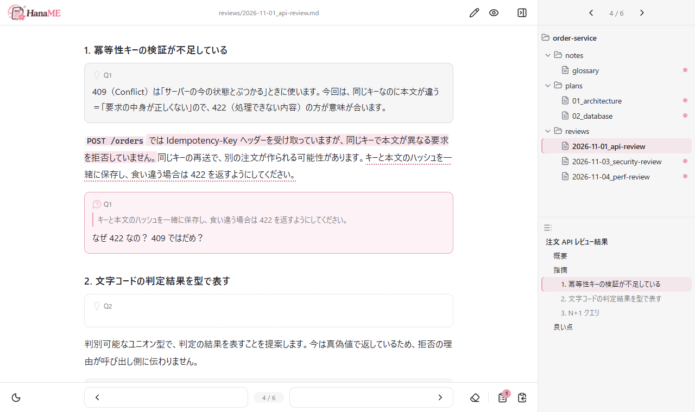
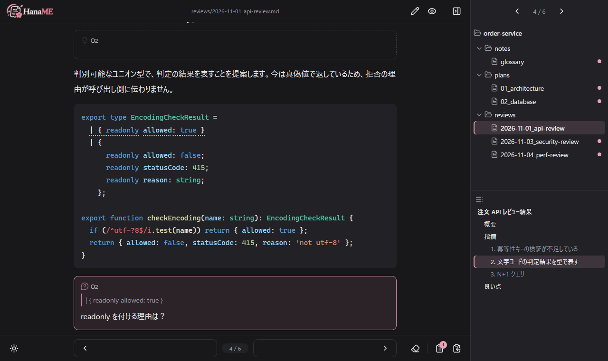

<p align="center">
  
</p>

<h3 align="center"> md ファイルを、まとめて読んで、まとめて聞く。</h3>

<p align="center">
  AI が書いた大量の .md を、要約せずに読み切るためのローカルビューア。<br>
  <b>API 不要。</b>いま使っている AI ツールに、そのままつながります。
</p>


<p align="center">
  
</p>

---

## 大量の md ファイル、読み切れていますか？

AI を使った開発では、レビュー・設計・調査の .md が次々に生成されます。開発の速度に、読む側が追い付きません。

- 1 つ 1 つが長く、数も多い
- 分からない一文が出るたびに、AI のチャットへ移って聞き直す
- 往復が面倒になって、要約で済ませたり、読み飛ばしたりする

HanaME（花見）は、この往復を **1 回にまとめます**。

1. **読む** — 分からない文をクリックして、その場で質問を書き込む（何個でも、何ファイルでも）
2. **まとめて聞く** — すべての質問を、1 つの指示文として AI に渡す
3. **答えが本文の中に届く** — AI が .md に直接回答を書き込み、画面がすぐ更新される

## 特長

- **要約しない** — 原文のまま読む。AI の長い説明も縮めず、必要なら別の .md に分けて書かせる
- **1 文ずつ聞ける** — マウスを乗せた文がハイライトされ、クリックでその文への質問欄が開く。コードも 1 行ずつ
- **API 不要** — AI の API キーも課金もいらない。Claude Code・Codex・Cursor・ブラウザの AI チャットなど、いま契約している AI をそのまま使う
- **ファイルが正本** — 質問と回答は .md に普通の引用として書き込まれる。GitHub や他のエディタでもそのまま読める
- **手元だけで動く** — サーバーは自分のパソコンの中だけ。設定ファイルもいらない

<p align="center">
  
</p>

---

## はじめかた

### 必要なもの

- **Node.js 22.23.4 / 24.22.1 / 26.12.1 以降**
  （Node2Shell〔CVE-2026-111497〕の修正版。これより古い Node.js では起動しません）
- AI ツール（どれか 1 つ）
  - ファイルを読み書きできるもの: Claude Code、Codex CLI、Cursor、GitHub Copilot のエージェントモードなど
  - またはブラウザの AI チャット（中身ごとコピーして貼り付けます）

### インストール

```bash
git clone https://github.com/HarutarouKawamoto/haname.git
cd haname
npm install
npm link
```

`npm link` しておくと、どのフォルダでも `haname` コマンドが使えます。

### 起動

読みたいフォルダで起動します。ブラウザが自動で開きます。

```bash
cd your-project
haname
```

### AI ツールの準備（最初に一度だけ）

```bash
haname init
```

これで、AI に **「HanaME の質問に答えて」** と頼むだけで通じるようになります。`init` は次の 3 つを行います。

- `.gitignore` に作業フォルダ（`.haname/`）を追加する
- `CLAUDE.md` / `AGENTS.md` に Q&A のルールを書き足す（既にあるファイルは、元の内容を残して末尾に足す）
- `.claude/skills/haname-answer/` に、質問に回答する AI 用のスキルを置く

---

## 使い方

### 読む

| 操作 | 動き |
|---|---|
| ← → キー / 下部のページ送り | 前後のファイルへ（ツリーの並び順。フォルダをまたいで続く） |
| ツリーのファイルをクリック | そのファイルを開く |
| 目次の見出しをクリック | その見出しへ移動 |

- ツリーの **●** は未読、**○** は開いた後に更新されたファイルです。AI が回答を書き込んだファイルが一目で分かります。
- コードブロックは、言語名（` ```ts ` など）が書いてあれば VS Code と同じ配色で色分けされます（昼は Light+、夜は Dark+）。
- ` ```mermaid ` のコードブロックは、[Mermaid](https://mermaid.js.org/) の図として表示します。右上のボタンで図とコードを切り替えられます。
- 表・図・画像は、右上のボタンで画面いっぱいに拡大できます（ホイールで拡大・縮小、ドラッグで移動、Esc で閉じる）。
- `<details>` / `<summary>` の折りたたみが使えます。目次や Q&A の番号から閉じた折りたたみの中へ移動すると、自動で開きます。
- ボタンは文字を使わず、アイコン（Lucide）だけです。

### 質問する

| 操作 | 動き |
|---|---|
| 文にマウスを乗せる | 文単位でハイライト |
| 文をクリック | その文への質問欄が開く（Ctrl+Enter で書き込み、Esc でやめる）。コードブロックは 1 行ずつ |
| 言葉をなぞる | `「〇〇」とは？` の下書き付きで質問欄が開く |
| 図の部品（箱・矢印のラベル・登場人物）をクリック | その部品への質問欄が開く。図の何もないところなら図全体への質問。質問した部品は桜色に光る |
| 回答の中の文をクリック | 追加の質問（スレッド）になる |
| 質問・回答の番号をクリック | 対応する回答・質問へジャンプ |
| 何もないところをクリック | 質問欄を閉じる（書きかけのときは閉じない） |

### AI に答えてもらう

やり方は 3 通りあります。どれでも、回答が .md に入ると画面がすぐ更新されます。

| AI ツール | やり方 |
|---|---|
| Claude Code など（スキル対応） | 「**HanaME の質問に答えて**」と頼む。AI が自分で未回答の質問を探して答える |
| ファイルを読み書きできる AI ツール | 下部の **指示文をコピー** を押して、AI ツールに貼り付ける |
| ブラウザの AI チャット | 下部の **中身ごとコピー** を押して貼り付ける。返ってきたファイルで上書きする |

- 指示文には、フォルダ内の「未回答の質問がある .md」**すべて**がまとまります。ボタンのバッジは、フォルダ全体の未回答の数です。
- 説明が 10 行を超えそうな質問では、AI は回答を縮めません。回答欄には結論だけを書き、その質問のための新しい .md を提案します。了承すると、省略のない説明の .md を作り、回答欄からリンクします（スキル使用時）。

### 片付ける・戻す

| 操作 | 動き |
|---|---|
| 👁 Q&A を隠す | 画面上だけ Q&A を隠し、元の文章だけで読む（ファイルはそのまま） |
| ⌫ を 1 回 → もう 1 回 | Q&A をすべて削除 |
| ⌫ を 1 回 → 枠をクリックして選ぶ → もう 1 回 | 選んだ Q&A（質問と回答の組・スレッド）だけ削除 |
| Ctrl+Z / Ctrl+Shift+Z（Ctrl+Y） | 質問の追加・削除・編集の保存を元に戻す / やり直す |

AI などが後から書き換えたファイルは、Ctrl+Z でも戻しません（書き込まれた回答を消さないため）。

### 編集する・整理する

- 上部の ✎ で編集モードに入ります。編集画面には **本文だけ** が出ます。保存（Ctrl+S）すると、Q&A は元の位置関係に自動で戻ります。
- ツリーで Ctrl / Shift + クリックで複数選択し、フォルダへドラッグすると移動できます。他の .md からのリンクが切れる場合は、件数を表示して確認します。

---

## Q&A の書式

質問と回答は、.md に次の書式で書き込まれます。GitHub など他のビューアで開いても、普通の引用として読めます。

```markdown
## 見出し

> [!ANSWER] Q1
> （AI がここに回答を書く）

本文の段落。質問したい文。

> [!QUESTION] Q1 対象:「質問したい文。」
> 質問の内容
```

- 回答は、対象の文から一番近い見出しの直下に積み重なります。読み返すとき、本文の前に前提知識が目に入ります。
- 質問は、対象の段落の直後に入ります。
- 回答への追加の質問は `Q1-1`、`Q1-1-1` のように枝分かれします。
- 初めて書き込む前の元のファイルは、`.haname/backup/` に残ります。

---

## コマンド

| コマンド | できること |
|---|---|
| `haname [フォルダ]` | ビューアを起動する。そのフォルダで起動済みなら、それを開くだけ |
| `haname docs/plan.md` | そのファイルを開いた状態で起動する。起動済みなら、画面がそのファイルに切り替わる |
| `haname prompt [--full]` | 未回答の質問をまとめた AI への指示文を出力する（`--full` で中身も含める） |
| `haname init` | AI ツールの準備（`.gitignore`・`CLAUDE.md` / `AGENTS.md`・スキル）。何度実行しても重複しない |
| `haname clean [ファイル…] [--dry-run]` | Q&A を取り除く。省略時はフォルダ内すべて |
| `haname check [ファイル…] [--staged]` | Q&A が残っていれば一覧を出して失敗（終了コード 1）で終わる。`--staged` は git のステージ済みの内容を調べる |

起動オプション: `--port <番号>`（初期値 4747）/ `--no-open`（ブラウザを開かない）/ `--ai-files`（AI ツールの設定・指示のファイルも表示する）

### コミット前に Q&A の消し忘れを防ぐ

`.git/hooks/pre-commit` に次を書いておくと、Q&A が残った .md をコミットしようとしたときに止まります。

```bash
#!/bin/sh
haname check --staged
```

npm に公開するまでは、`npx haname` と書かないでください。同じ名前の別のパッケージを実行してしまうおそれがあります。

---

## 詳しい仕組み

<details>
<summary>AI 用のスキル</summary>

`haname init` は、[Claude Code](https://claude.com/claude-code) などのスキル（SKILL.md）に対応した AI ツール向けに、`.claude/skills/haname-answer/SKILL.md` を置きます。元のファイルは [skills/haname-answer/SKILL.md](skills/haname-answer/SKILL.md) です。

- AI は「質問に答えて」と頼まれたときだけ、この手順を読み込みます。
- すべてのプロジェクトで使いたいときは、`~/.claude/skills/haname-answer/` にコピーしてください。
- `haname init` を実行し直すと、最新の内容に置き換わります。自分で書き換えて使うときは、ファイル内の `<!-- haname:managed` の行を消してください。消したファイルは上書きしません。
- スキルに対応していない AI ツールのために、`CLAUDE.md` / `AGENTS.md` にも同じルールを書いています。

</details>

<details>
<summary>CLAUDE.md / AGENTS.md への書き込み</summary>

- 書き込む部分は `<!-- haname:start -->` と `<!-- haname:end -->` で囲みます。実行し直すと、囲みの中だけを最新にします。囲みの外には触れません。
- 両方あれば両方に、どちらもなければ `CLAUDE.md` を作って書きます。改行コード（CRLF / LF）は元のファイルに合わせます。
- 囲みの印が片方だけ・複数・順番が逆のときは、どこまでが HanaME の部分か分からないため、そのファイルは変更せずに知らせます。

</details>

<details>
<summary>表示しないファイル</summary>

ツリーには、`node_modules`・`.git`・`.haname` と `.gitignore` の対象は表示されません。

AI ツールの設定・指示のファイルも、初期設定では表示しません（`--ai-files` を付けて起動すると表示します）。

- フォルダ: `.claude`・`.cursor`・`.windsurf`・`.codex`・`.gemini`・`.agents`・`.clinerules`・`.roo`・`.continue`・`.kiro`・`.junie`・`.amazonq`・`.augment`・`.opencode`
- ファイル: `CLAUDE.md`・`CLAUDE.local.md`・`AGENTS.md`・`AGENT.md`・`GEMINI.md`（どのフォルダにあっても）
- `.github` の中の `copilot-instructions.md`・`instructions/`・`prompts/`・`agents/`・`chatmodes/`

</details>

<details>
<summary>作業フォルダ（.haname/）</summary>

起動したフォルダに `.haname/` を作ります。`.gitignore` に入れておいてください（`haname init` で自動追加されます）。

| ファイル | 中身 |
|---|---|
| `backup/` | 初めて質問を書き込む直前の、元のファイル（保険） |
| `state.json` | 既読の記録（● / ○ の目印に使う） |
| `server.json` | 起動中のサーバーの情報（CLI から見つけるため。終了時に消える） |

</details>

---

## セキュリティ

- サーバーは `127.0.0.1` だけで待ち受け、外部からは接続できません。
- DNS リバインディング・他サイトからの書き込み（CSRF）・クリックジャッキングを防ぐ対策を入れています。
- 読み書きできるのは、起動したフォルダの中の、ツリーに表示される .md だけです（`../` やシンボリックリンクでフォルダの外を指すものは拒否）。
- Markdown の生の HTML は描画せず、ページには CSP を設定しています。例外は折りたたみの `<details>` / `<summary>` だけで、属性（`open` 以外）は捨てて組み立て直します。
- Mermaid の図は `securityLevel: 'strict'` で描き、図の中のリンク・スクリプト・クリック動作は無効にしています。

**気をつけること**: .md の中身はそのまま AI への指示文に入ります。他人から受け取った .md に AI 向けの指示が埋め込まれていると、AI がそれに従う可能性があります（プロンプトインジェクション）。

詳しくは [docs/SPEC.md](docs/SPEC.md) の「セキュリティ」を参照してください。

---

## 開発者向け

```
bin/haname.js     CLI（起動・prompt・init・clean・check）
lib/server.js     ローカルサーバー（ファイル一覧・読み書き・変更通知・移動・元に戻す）
lib/qa.js         Q&A ブロックの読み取り・追加・削除、編集時の本文と Q&A の分離・再合成
lib/prompt.js     AI への指示文（画面と CLI で共通）
public/           画面（index.html / app.js / style.css / boot.js / brand/ / vendor/）
skills/           AI 用のスキル（haname init で .claude/skills/ に置く）
docs/SPEC.md      仕様
docs/images/      README の画像
scripts/update-mermaid.mjs  Mermaid の取り込み（node scripts/update-mermaid.mjs <版>）
```

依存パッケージ: [markdown-it](https://github.com/markdown-it/markdown-it)（Markdown の描画）、[highlight.js](https://highlightjs.org/)（コードの色分け）、[lucide-static](https://lucide.dev/)（アイコン）、[ignore](https://github.com/kaelzhang/node-ignore)（.gitignore の判定）

Mermaid は npm の依存には入れず、ブラウザ用の 1 ファイル（`public/vendor/mermaid.min.js`、MIT）だけを取り込んでいます（パッケージ全体は 140MB を超えるため）。中に含まれる部品のライセンス表示は [public/vendor/mermaid.LICENSES.txt](public/vendor/mermaid.LICENSES.txt) にあります。

## ライセンス

[MIT](LICENSE)
