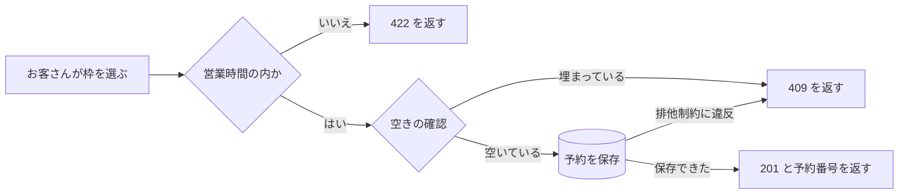

# 予約の流れ

予約の作成は、入力の確認・空きの確認・保存の 3 段階で進む。保存の段階で、データベースがもう一度重なりを確かめる。

## 段階ごとの役割

1. **入力の確認** — 営業時間の外や、終わりが始まりより前の枠を断る
2. **空きの確認** — 同じ席の予約を読み、時間帯が重ならないかを見る
3. **保存** — 空きの確認と保存のあいだに別の予約が入っても、ここで止める
